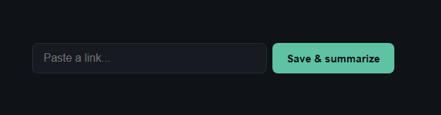

# read-later

A private, password-protected reading hub with two halves:

- **Articles**: paste a link, it fetches the page, extracts the article text, and summarizes it (summary +
  key points + tags) via a shared [1min.ai](https://1min.ai) proxy.
- **Books**: track the book series you're reading in your own read order, search
  [Open Library](https://openlibrary.org) and [Hardcover](https://hardcover.app), browse by subject, and
  get AI "more like this" picks.

No Discord bot, no browser extension. Just a web app behind one password.

## Login

Everything except `/login` and `/static/` sits behind a single password (`APP_PASSWORD`). Logging in sets
an HMAC-signed session cookie (`HttpOnly`, `SameSite=Lax`, `Secure` when served over HTTPS) valid for
`SESSION_DAYS`. After 5 wrong passwords from one IP within 15 minutes, that IP is locked out until the
oldest failure ages out. The app refuses to start without `APP_PASSWORD`, so a missing `.env` line can't
leave it open.

Changing `APP_PASSWORD` logs out every existing session (unless you set your own `SECRET_KEY`).

## Articles: how it works

1. Paste a URL into the box on `/`.



2. The app fetches the page and extracts clean article text, trying [readability-lxml](https://github.com/buriy/python-readability)
   first (it avoids nav/sidebar blocks that trip up density-based extractors on some news sites), falling
   back to [trafilatura](https://github.com/adbar/trafilatura) if that comes back too short.
3. The extracted text is sent to 1min.ai for summarization (model configurable via `MODEL_SUMMARIZER`).
4. The result (title, summary, key points, tags, full text) is stored in SQLite and shown as a card in the
   grid under the link box on the home page (3 columns on desktop; **Inbox** / **Archived** switch above it).

Failed extractions/summaries are stored with a `failed` status and can be retried from the article page.

## Books: how it works

`/books` shows every series as a card with your progress (`4/9`), the next unread book with a one-click
**Start** / **Finished** button, and a strip of covers in read order. Standalone books are listed below.
Finished series (every non-skipped book read) and standalone books marked Read move to an **Already read**
section at the bottom of the page, with the date you finished.

**Where the data comes from:**

| Source | Used for | Needs |
|---|---|---|
| Open Library | book search, covers, subjects, subject browse | nothing (keyless) |
| Hardcover | series search, importing a whole series with its numbering, syncing a series later | `HARDCOVER_TOKEN` |

Open Library has no reliable series data, so without a Hardcover token you build series by hand (create a
series, then add books to it from search). With a token, search for a series (pick **Series** next to the
search box) and **Import series + read order** pulls every book in. Hardcover filters out merged
duplicates, partial editions and compilations, the same way its own series pages do.

**Read order is yours.** Imported series start in series-number order, but you can drag rows (or use the
↑/↓ buttons, which also work on phones) to read prequels, novellas or chronological order however you
like. **Reset to series order** re-sorts by the `#` numbers. **Sync from Hardcover** adds books that came
out since you imported, appended to the end of your order. A manual series can be linked to Hardcover
later. Its existing books are matched by title, so nothing gets duplicated.

Each book has a status: *To read*, *Reading*, *Read* (records the finish date) or *Skipping* (excluded from
progress counts, handy for novellas you don't care about).

**Finding similar books:**

- Click any subject chip (e.g. *Space opera*) to browse top-rated Open Library books with that subject.
  Free, no LLM involved.
- **Recommend similar (AI)** on a series or book page asks the model (`MODEL_RECOMMENDER`) for 6 picks,
  given the seed and a list of what's already in your library so it doesn't suggest those. Results are
  cached per series/book. They're only regenerated when you click **Refresh AI picks**, so viewing the page
  costs no credits. Each pick has a **Find** link that runs a search for it. The prompt lives in
  `app/prompts/recommender_system_prompt.txt` (bind-mounted, editable without a rebuild).

**Books no database has yet** (e.g. a self-published release from this week): use **+ Add manually** on a
series page or at the bottom of search results. Give it a title, author and (optionally) series # and year;
with a series # it slots in after the previous number. Manual books link themselves later, filling in
cover, year and series # without overwriting what you typed:

- every background check retries up to 8 of them on Hardcover, then Open Library (a match needs the same
  title, ignoring punctuation and "One"/"1", and the same author surname; books without an author are
  never auto-linked);
- if the new-release check sees the book from a followed author or watched series, it links it on the spot;
- **Sync from Hardcover** on the series page matches by title too;
- the book page has **Look it up now** while it's still unlinked.

### English / French

The flags in the header switch the whole interface between English and French (remembered for a year in
the `rl_lang` cookie; with no choice made, a French browser gets French). Every page, message, button and
the reading-map labels are translated (`app/fr_texts.py`, English text as the key, so anything missing just
shows in English).

**Book titles follow too.** Each book can have a French title:

- filled in automatically from Hardcover's most popular French edition (subtitles glued onto French titles,
  like "Némésis: la guerre des ombres", are trimmed) during the background check, or right away with
  **Find French titles** on a series page;
- typed or corrected on the book page ("French title"); a title you type is never overwritten;
- books that were never translated keep their original title, and the book page shows the original under a
  French one.

Series, section and arc names can have French names too (the Heresy and Discworld presets ship them: *Les
Annales du Disque-monde*, *Acte 1 · Par où commencer*…). New article summaries and AI suggestions are
written in the language you're using.

### Reading maps

A series can have a **reading map**: its books grouped into sections and arcs joined by lines, like the
reading-order charts people post for the Horus Heresy or Discworld. The series page then gets three views:

- **Map**: sections top to bottom. *Arc columns* sit side by side; *rows*, *rows with branches*, *single
  columns* and *any order* groups hold one group each. Clicking a book ticks it (To read → Reading → Read,
  saved immediately); ↗ opens it. A book gets **Up next** once everything leading into it is read, so a
  branching series shows one badge per thread you can pick up. Lines you've travelled light up.
- **List**: the same map as plain lists. If a column section carries a narrative order (presets do), it's
  shown as one numbered list in that order.
- **Order**: the classic drag-to-reorder list.

**Presets** (Books → *Reading-map presets*) build a whole map in one go:

| Preset | Source | Titles |
|---|---|---|
| The Horus Heresy + Siege of Terra | wasniahC's *Horus Heresy Reading Order – Narrative Arcs* chart (2022-01-12): Act 1, Act 2's 49 entries in 10 arc columns plus anthologies, Act 3; Siege of Terra appended | 97, with dots for the chart's 23 narrative lines and anthology contents on hover |
| Discworld | character arcs | 41 novels |

Applying one matches books you already have by title and aliases (e.g. *Garro* ↔ *Garro (Parts 1–2)*), also
pulling them in from related series (anything named like the preset, e.g. a separate *Siege of Terra*
series) and standalones. Missing titles are created as manual books. Discworld's link themselves to
Hardcover/Open Library later; the Heresy's novellas and shorts are added without an author, so they don't
auto-link (fill in the author on a book's page and it will). You can tick
"mark everything unread". Books in the series the preset doesn't cover land in **Not placed in the map
yet**, never deleted. Re-applying is safe (no duplicates).

**Any other series:** press **+ Build a reading map** on its page. It starts as one arc with every book;
the editor lets you add sections and arcs, move books between them, reorder, label them ("#3", "Novella"),
set rows/indents for branching rows, and add crossover / side-story lines. Sections with *auto-wire* on are
joined to the previous one automatically.

**Catching up on a long series:** every row on a series page has **✓ Read all above**, which marks
every earlier book in your read order as Read in one click (skipped books stay skipped).

### New releases

Follow authors (the **+ Follow** button on any book or series page, or **New releases & following** on
the Books tab) and the app checks Hardcover in the background every `WATCH_INTERVAL_HOURS` (default 6) for
recent and upcoming books by them. Series you imported or linked from Hardcover are watched automatically,
so new Horus Heresy books show up without following every author who writes for it.

New finds appear in a small panel at the top left of every page once you're logged in: the first 3, then
**Show N more**. Each one has **Add** (into the matching series if you have it) and **×** to dismiss it for
good. Closing the panel hides it for the rest of that browser session; it comes back on your next visit, or
as soon as something new turns up. Books already in your list (e.g. an upcoming entry that came in with a
series import) only pop up on release day.

Each check is a single Hardcover request no matter how many authors and series you track, and it looks
back `WATCH_LOOKBACK_DAYS` (default 21) to catch books Hardcover's librarians add a few days after release.
Nothing is sent anywhere: notifications only exist inside the app.

### Getting a Hardcover token

1. Create a free account on [hardcover.app](https://hardcover.app).
2. Settings → **Hardcover API** → **New API Key**.
3. Tick only the **`read:catalog`** scope. That's all this app needs, and it can't touch your Hardcover
   library or account.
4. Paste it into `.env` as `HARDCOVER_TOKEN=...` (with or without the `Bearer ` prefix) and recreate the
   container.

The free plan allows 60 requests/minute and 5,000/day. A search costs 1 request, a series import or sync
costs 1.

## Stack

FastAPI (async) + httpx + SQLite + Jinja2 templates, no JS framework (a few lines of vanilla JS for
drag-to-reorder). Dockerized.

## Running locally

```bash
cd app
pip install -r requirements.txt
cp ../.env.example .env   # fill in ONE_MIN_API_KEY and APP_PASSWORD
uvicorn main:app --reload
```

## Running with Docker

```bash
cp .env.example .env   # fill in ONE_MIN_API_KEY and APP_PASSWORD
docker compose up -d --build
```

The app listens on port `8086` by default (see `docker-compose.yml`). Books data lives in the same SQLite
file as articles (`data/read-later.db`). The new tables are created automatically on first start.

## Exposing it publicly

See [deploy/README.md](deploy/README.md) for the nginx reverse-proxy + certbot setup used for
later.vaultinc.fr.

## Config

All settings are environment variables (see `.env.example`):

| Variable | Default | Notes |
|---|---|---|
| `ONE_MIN_API_KEY` | — | required |
| `APP_PASSWORD` | — | required, the single login password |
| `SECRET_KEY` | derived from `APP_PASSWORD` | optional, signs session cookies |
| `SESSION_DAYS` | `30` | how long a login lasts |
| `HARDCOVER_TOKEN` | empty | optional, enables series search/import, following and new-release checks (scope `read:catalog`) |
| `WATCH_INTERVAL_HOURS` | `6` | how often the new-release check runs |
| `WATCH_LOOKBACK_DAYS` | `21` | how far back each check looks for recently released books |
| `ONE_MIN_BASE_URL` | `https://api.1min.ai` | |
| `MODEL_SUMMARIZER` | `us.anthropic.claude-haiku-5-5` | any model ID 1min.ai's `chat-with-ai` accepts |
| `MODEL_RECOMMENDER` | `us.anthropic.claude-haiku-5-5` | used for book recommendations |
| `DB_PATH` | `/data/read-later.db` | |
| `MAX_ARTICLE_CHARS` | `20000` | article text is truncated to this before summarizing |
